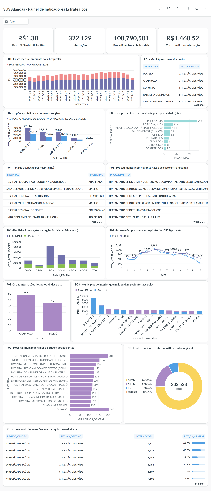

# Data Warehouse Saúde Alagoas

Data Warehouse de ponta a ponta com dados públicos do SUS: **16,9 milhões de registros**
de internações (SIH), produção ambulatorial (SIA) e leitos (CNES) de Alagoas, de 2023 a
2024. O projeto vai da extração no FTP do DATASUS até um painel no Metabase. Tudo roda em
Docker e sobe com um comando.

**Stack:** Python · Apache Airflow · Oracle Database 23 · SQL · Docker · Metabase · Postgres

## Destaques

- **Arquitetura medalhão** (bronze → silver → gold → mart) com 37 tabelas e um modelo
  estrela de 3 fatos e 8 dimensões.
- **Pipeline idempotente:** rodar a carga duas vezes dá exatamente o mesmo resultado, sem
  duplicar nada (partições truncadas por ano, `MERGE` nas dimensões).
- **Qualidade comprovada a cada carga:** 0 linhas repetidas, valores financeiros iguais em
  todas as camadas (R$ 493,6 mi no SIH, R$ 860,2 mi no SIA) e 17 chaves estrangeiras
  validadas pelo Oracle.
- **Performance de DW:** carga direct-path, compressão, particionamento, índices bitmap e
  tablespaces separados. A fato ambulatorial agrega 16,5 milhões de registros em 1,1
  milhão de linhas.
- **Infraestrutura como código:** o banco, o schema e o painel do Metabase são criados por
  script, com versões fixas de todas as imagens e bibliotecas.

## Painel



## O que os dados mostram

| Pergunta | Resultado |
|---|---|
| Os pacientes são internados perto de casa? | 74,6% das internações acontecem na própria região de saúde; 25,4% exigem deslocamento |
| Quanto os polos dependem do interior? | 45,0% das internações em Maceió e 58,4% em Arapiraca são de pacientes do interior |
| Qual especialidade ocupa o leito por mais tempo? | Psiquiatria: média de 51,4 dias por internação, contra 13,6 da segunda colocada |
| Quando as doenças respiratórias pressionam a rede? | Picos em maio nos dois anos (1.212 internações em 2023 e 1.285 em 2024) |
| Quem mais usa a urgência? | Mulheres de 15 a 29 anos: 28,5% das internações de urgência |
| O custo do mesmo procedimento varia entre hospitais? | Em 233 procedimentos comparáveis, o hospital mais caro cobra em média 2,4 vezes o mais barato |

O painel responde a 10 perguntas de negócio, cada uma com uma tabela mart própria:

| # | Pergunta | Mart |
|---|---|---|
| 1 | Custo total e volume de atendimentos (ambulatorial + hospitalar) por mês e município | `MART_P01_CUSTO_VOLUME_MUNICIPIO` |
| 2 | Top 5 especialidades de leito mais demandadas na 1ª e na 2ª Macrorregião | `MART_P02_TOP_ESPECIALIDADES` |
| 3 | Tempo médio de permanência por especialidade do leito | `MART_P03_PERMANENCIA_ESPECIALIDADE` |
| 4 | Taxa de ocupação por hospital (pacientes-dia ÷ leitos SUS-dia) | `MART_P04_OCUPACAO_HOSPITALAR` |
| 5 | Variação do custo médio do mesmo procedimento entre hospitais | `MART_P05_CUSTO_PROCEDIMENTO` |
| 6 | Perfil (faixa etária × sexo) das internações de urgência | `MART_P06_PERFIL_URGENCIA` |
| 7 | Meses com picos de internação por doenças respiratórias (CID J00–J99) | `MART_P07_RESPIRATORIAS_MENSAL` |
| 8 | Fluxo de pacientes do interior para os polos Maceió e Arapiraca | `MART_P08_FLUXO_POLOS` |
| 9 | Hospitais "hub": quais recebem pacientes de mais municípios | `MART_P09_HUBS_HOSPITALARES` |
| 10 | Transbordo de internações entre regiões de saúde | `MART_P10_TRANSBORDO_REGIOES` |

## Arquitetura

```
FTP DATASUS (SIH, SIA, CNES, TAB_SIA, TAB_SIH)  +  API IBGE
        │
        ▼
 BRONZE  ── cópia fiel da origem, mesmos nomes de colunas (8 tabelas)
        │
        ▼
 SILVER  ── dado limpo, tipado, com descrições oficiais (8 tabelas)
        │
        ▼
 GOLD    ── star schema: 8 dimensões + 3 fatos
        │
        ▼
 MART    ── 1 tabela por pergunta de negócio (10 tabelas)  ──▶  Metabase
```

| Serviço | Papel | Endereço | Acesso |
|---|---|---|---|
| Airflow | orquestração (1 task por tabela) | http://localhost:8080 | admin / admin |
| Oracle 23 Free | Data Warehouse | localhost:1521/FREEPDB1 | DW_ALAGOAS / dw_password_123 |
| Metabase | painel de indicadores | http://localhost:3000 | dwalagoas@dwalagoas.com / dw_password_123 |
| Postgres | metadados do Airflow e do Metabase | interno | — |

As credenciais são de um ambiente local de demonstração.

## Como executar

Pré-requisito: Docker com Docker Compose.

```bash
git clone https://github.com/yurygalvao/dw_saude_alagoas.git
cd dw_saude_alagoas
docker compose up -d --build
```

1. Aguarde o Oracle ficar `healthy` (`docker ps`). Na primeira subida, ele cria os
   tablespaces e o owner `DW_ALAGOAS`, e o Metabase é configurado sozinho (usuário,
   conexão com o Oracle e o painel **SUS Alagoas - Painel de Indicadores Estratégicos**).
2. No Airflow, dispare a DAG **`dag_etl_saude_alagoas`** por **Trigger DAG w/ config** e
   marque **`carregar_bronze`**. A primeira carga leva cerca de 1h10, quase todo esse tempo
   baixando os arquivos do SIA.
3. Nas execuções seguintes, sem `carregar_bronze`, a DAG reaproveita o bronze e reprocessa
   o resto em cerca de 8 minutos.

No Linux, rode antes `echo "AIRFLOW_UID=$(id -u)" > .env`.

### Período e agendamento

Os anos de 2023 e 2024 foram escolhidos apenas para o desenvolvimento. O período é
configurável na variável `ANOS_PIPELINE` do `docker-compose.yaml`, e qualquer ano
disponível no DATASUS pode ser carregado.

O DW também está pronto para rodar de forma automática, por exemplo diariamente para a
SESAU-AL: basta definir o `schedule` da DAG (como `@daily`). Como a carga é idempotente,
cada execução reprocessa o período sem duplicar dados, e os novos arquivos mensais do
DATASUS entram assim que são publicados.

## Pipeline

```
aplicar_schema → bronze (8) → silver_dominio → silver (7) → dimensões (8)
  → desabilitar_fks → FATO_INTERNACAO → FATO_PRODUCAO_AMBULATORIAL → FATO_LEITOS
  → habilitar_fks (VALIDATE) → marts (10)
```

Cada tabela é carregada por um notebook executado pelo papermill, que registra um log
padronizado de registros lidos e gravados:

```
PAAL2301.dbc baixado: 14.2 MB em 9s
BRONZE_SIA <- PAAL2301.dbc: 588.573 lidos, 588.573 gravados
DIM_MUNICIPIO: 5.571 lidos, 0 gravados, 0 inseridos, 0 atualizados, 5.572 na tabela
```

| Camada | Estratégia de carga | Idempotência |
|---|---|---|
| Bronze SIH/SIA/Leitos | arquivos mensais, insert direct-path em lotes | `TRUNCATE PARTITION` do ano antes de recarregar |
| Bronze cadastros e silver | full (`TRUNCATE` + `INSERT APPEND`) | recarga completa |
| Dimensões | incremental (`MERGE`, SCD tipo 1) com SK de sequence | só insere o que é novo e só atualiza o que mudou; as SKs não mudam entre execuções |
| Fatos e marts | full (`TRUNCATE` + `INSERT APPEND`) | recarga completa |

As FKs das fatos ficam desabilitadas durante a carga, o que permite o direct-path, e são
reabilitadas com `VALIDATE` no fim, comprovando a integridade de toda a carga. O download
do FTP tem novas tentativas com limite de tempo, porque o servidor do DATASUS é instável.

## Modelo dimensional

| Fato | Grão | Medidas | PK |
|---|---|---|---|
| `FATO_INTERNACAO` | 1 AIH paga por competência | QTD_INTERNACAO, QTD_DIAS_PERMANENCIA, VL_TOTAL, QTD_OBITO | estabelecimento + AIH + tipo + sequencial + competência + data de saída |
| `FATO_PRODUCAO_AMBULATORIAL` | competência × município de residência × município de atendimento × estabelecimento × procedimento | QTD_REGISTROS, QTD/VL apresentados e aprovados | as 5 FKs |
| `FATO_LEITOS` | competência × estabelecimento (snapshot) | QTD_LEITOS_EXISTENTES, QTD_LEITOS_SUS (semiaditivas) | as 2 FKs |

**Dimensões:** `DIM_TEMPO` (chave `AAAAMMDD`), `DIM_MUNICIPIO`, `DIM_ESTABELECIMENTO`,
`DIM_PROCEDIMENTO`, `DIM_CID`, `DIM_ESPECIALIDADE`, `DIM_CARATER_ATENDIMENTO` e
`DIM_PERFIL_PACIENTE` (dimensão *junk* sexo × faixa etária). As surrogate keys vêm de
sequences, e toda dimensão tem o membro **`SK = -1` (NAO INFORMADO)**: nenhuma linha de
fato é descartada por chave inválida. A `FATO_INTERNACAO` tem as dimensões degeneradas
`NUM_AIH`, `TIPO_AIH`, `SEQ_AIH5` e `ANO_MES_CMPT`.

## Regras de negócio e qualidade dos dados

- **Sem dupla contagem:** a AIH de longa permanência (`IDENT = 5`) é continuação de uma
  internação já contada. Ela soma valor e dias, mas tem `QTD_INTERNACAO = 0`, como no
  TabNet do DATASUS.
- **Residência não informada:** 9,7% dos registros do SIA vêm com município `999999`,
  porque o BPA consolidado não identifica o paciente. O valor é mantido no membro
  "NAO INFORMADO" e entra nos totais.
- **Glosas:** os indicadores usam quantidade e valor **aprovados**, o que de fato foi pago.
- **Padronização:** idade convertida para anos e agrupada em 7 faixas; sexo do SIH (1/3)
  mapeado para M/F; caracteres de controle removidos das descrições.
- **Descrições oficiais:** regiões e macrorregiões de saúde, tipos de unidade,
  complexidade, caráter, especialidade e CID vêm das tabelas do DATASUS (TAB_SIA e
  TAB_SIH), não de listas digitadas no código.

## Performance

| Prática | Onde |
|---|---|
| Tablespaces separados: dados (`TS_DW_DADOS`) e índices (`TS_DW_INDICES`) | todo o DW |
| Insert direct-path (`APPEND` / `APPEND_VALUES`) e `COMPRESS` | cargas e tabelas grandes |
| Partição por ano (`LIST AUTOMATIC`) com `TRUNCATE PARTITION` | bronze SIH/SIA/Leitos |
| Partição mensal (`INTERVAL`) e índices locais | `FATO_PRODUCAO_AMBULATORIAL` |
| Índices **bitmap** nas FKs das fatos | fatos |
| Sem índices em bronze, silver e marts (full scan ou tabelas pequenas) | — |
| Fato ambulatorial agregada no grão das FKs (16,5 milhões → 1,1 milhão de linhas) | `FATO_PRODUCAO_AMBULATORIAL` |
| Estatísticas na carga + `DBMS_STATS` (cascade) | fatos e bronze particionada |
| Transformações em SQL dentro do banco | silver, gold, marts |

## Estrutura do projeto

```
dags/dag_etl_saude_alagoas.py        DAG: orquestra a carga (1 task por tabela)
notebooks/dw_utils.py                conexão, download do FTP, carga em lote e log
notebooks/bronze|silver|gold|mart/   1 notebook por tabela
sql/00_init_owner.sql                tablespaces e owner DW_ALAGOAS (roda como SYS)
sql/schema.sql                       DDL completo: fonte única da estrutura do DW
metabase/criar_painel.py             cria usuário, conexão, perguntas e painel no Metabase
metabase/init_postgres.sql           banco próprio do Metabase no Postgres
metabase/ojdbc8.jar                  driver JDBC do Oracle para o Metabase
Dockerfile, requirements.txt         imagem do Airflow com dependências fixas
docker-compose.yaml                  todos os serviços, com versões fixas
```

## Portabilidade

- **Versões fixas:** Airflow 2.8.1, Oracle 23 Free (fixado por digest), Metabase
  v0.65.2.2, Postgres 16 e bibliotecas Python.
- **Banco criado por script:** owner e tablespaces na primeira subida do Oracle, e tabelas
  pela task `aplicar_schema`.
- **Painel como código:** o `metabase/criar_painel.py` recria o painel a cada `up`, sem
  duplicar.
- **Sem arquivos temporários:** os downloads vão para pastas temporárias apagadas
  automaticamente. A única pasta gerada é `logs/`.

Para recomeçar do zero (apaga todos os dados):

```bash
docker compose down -v
docker compose up -d --build
```

## Próximos passos

- Modelar em grafo (Neo4j) os fluxos das perguntas 8, 9 e 10: municípios, hospitais e
  regiões como nós, e os deslocamentos de pacientes como arestas.

## Licença

Código sob a licença MIT (veja [LICENSE](LICENSE)).

- O driver `metabase/ojdbc8.jar` é da Oracle e segue a licença própria dela (Oracle Free
  Use Terms and Conditions), que permite a redistribuição.
- O repositório não contém dados. Os dados do DATASUS e do IBGE são públicos e são
  baixados pela própria DAG.

## Autor

**Yury Galvão Araújo** · [LinkedIn](https://www.linkedin.com/in/yury-galv%C3%A3o-370252325/) · [GitHub](https://github.com/yurygalvao)
